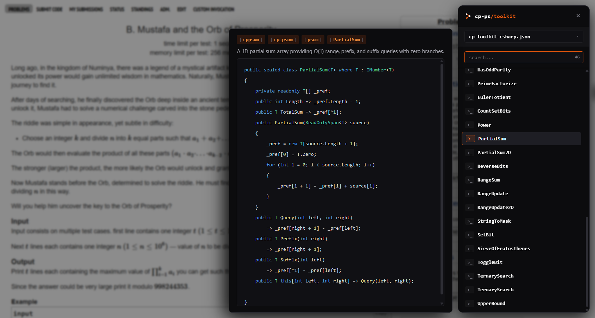

<p align="center">
  <picture>
    
  </picture>
</p>

<p align="center">
  <a href="https://github.com/call911kid/cp-ps-toolkit/actions"></a>
  <a href="https://github.com/call911kid/cp-ps-toolkit/releases"></a>
  <a href="LICENSE"></a>
  <a href="https://www.npmjs.com/package/cp-ps-toolkit"></a>
  <a href="https://www.npmjs.com/package/cp-ps-toolkit"></a>
  
  
  
  
</p>

## About

After 3 years of C++, I switched to C# and wanted a toolkit that follows my workflow wherever I code.

When solving problems, I constantly jump between my local editor and online judges. This toolkit keeps my templates, data structures, and past contest notes ready in both places, so I can focus on the problem itself instead of digging through old submissions, rewriting code under time pressure, or falling into the same traps.

This repository also archives 30+ original problems I wrote as a problem setter for ACPC, marathons, and CodeChef.

## In Your Editor (VS Code, Visual Studio, Rider)

> Native snippets and auto-expanding templates with automatic dependency resolution.

- **Multiple shortcut triggers**: Type a prefix shortcut or method name (like `BinarySearch` or `cp-bs`), then press Tab to insert the code template.
- **Automatic dependencies**: If an algorithm needs helper code (like GCD or modular inverse), the snippet brings it in automatically.
- **Supported editors**: Currently supports **VS Code** (`.code-snippets`), **Visual Studio** (`.snippet`), and **JetBrains Rider** (`.xml` live templates).
- **Included templates**: My own C# and C++ implementations of algorithms and data structures I use in contests.

### Install Snippets

Use the npm package `cp-ps-toolkit` to install snippets directly into your editors:

```bash
# Install C# snippets into all detected editors (VS Code, Visual Studio, Rider)
npx cp-ps-toolkit

# Install C# snippets into VS Code only
npx cp-ps-toolkit --editor vscode

# Install C++ snippets into Visual Studio
npx cp-ps-toolkit --lang cpp --editor vs

# Install C# snippets into JetBrains Rider
npx cp-ps-toolkit --lang cs --editor rider

# Export snippets into a local folder
npx cp-ps-toolkit --editor vscode --output .vscode

# Remove installed snippets from editors
npx cp-ps-toolkit --remove
```

## In Your Browser (Web Extension)

> A side panel to search, preview, and copy snippets directly on Codeforces, LeetCode, AtCoder, or your own custom domains.

- **Docked side panel**: Sits on the edge of problem pages with keyboard shortcut `Alt+C`.
- **Live code preview**: Inspect snippets and copy code to clipboard with one click.
- **Custom site controls**: Choose which websites it runs on.




### Install Extension

The extension is currently under review by the Google Chrome Web Store team. You can download and run it right now using the CLI:

```bash
npx cp-ps-toolkit --extension
```

To load it into your browser:
Open `chrome://extensions` (or `edge://extensions`) -> turn on Developer mode -> click Load unpacked -> select the exported folder.

## Build Your Own Snippets

You do not have to use only my templates. You can turn your own code into snippets:
1. **Tag your code**: Add `// @snippet <name>` and `// @require <dependency>` above your functions.
2. **Run the generator**: Use the tools in [`tools/generators/`](tools/generators) to compile your code into native snippets for VS Code, Visual Studio, or JetBrains Rider.
3. **Import into the extension**: You can also export your snippets and import them into the web extension to preview and copy your own code on your chosen websites (e.g., Codeforces, LeetCode, AtCoder).

## Tips & Tricks

See [tips-and-tricks.md](tips-and-tricks.md) for notes on traps I fell into during contests and habits I picked up while practicing.

